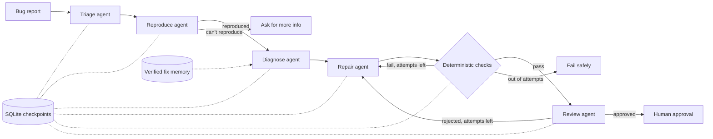

# MobileForge


An autonomous multi-agent system that takes a bug report for a mobile app, reproduces it, finds the root cause, writes a patch in an isolated git worktree, verifies it with real tests (Vitest, or Maestro on an Android emulator), and hands back a reviewable patch. Nothing ships without a human approving it.

The first target app is [Fineprint](https://github.com/ishan-barot/fineprint), my Expo / React Native phone-bill decoder.

## How it works



- **Agents propose, code decides.** No agent can mark its own work as passing. Verification is a fixed set of commands: the agent's repro test must now pass, the existing regression suite must still pass, and the TypeScript build must be clean (Android: the approved Maestro flows must pass on a fresh release build).
- **Stateful.** State is checkpointed to SQLite after every step. `mobileforge resume <run>` picks up a crashed run from the last finished step.
- **Bounded.** Max repair attempts, a per-attempt edit budget, per-command timeouts, and per-agent turn limits.
- **Long-term memory.** Verified fixes (passed hidden tests, or approved by a human) are stored as structured records and retrieved by category and text similarity. Failed or unverified patches never become memory.

| Agent | Tools | Output |
| --- | --- | --- |
| Triage | list, search, read | expected vs observed, acceptance criteria, search terms |
| Reproduce | write repro test, run tests (or Maestro flows) | a failing test, confirmed by re-running it outside the agent |
| Diagnose | search, read, run tests, logcat, fix memory | root cause, evidence, confidence, files |
| Repair | read, edit (editable paths only), run tests, diff | the patch |
| Review | read, search | approve or reject, risks, unnecessary changes |

## Safety model

The model never gets a shell. Every tool validates its input:
- edits only under the layer's editable folders (`packages/core/src/` or `apps/mobile/src/`), and only by exact, unique text replacement
- reads can't leave the repo or enter `node_modules`, `.git`, or build folders
- test runs are allowlisted paths, Maestro runs are allowlisted flow ids
- every run happens in its own git worktree, never in your real checkout
- hidden acceptance tests live outside the worktree, get copied in only to score the final patch, and are deleted right after

More in [architecture/](architecture/).

## Benchmark

`benchmark/cases/` holds reproducible defects planted into a pinned Fineprint commit. Each case has a plain-English bug report, a one-defect `break.patch`, and hidden acceptance tests the agents never see.

- 16 shared-core TypeScript cases (bill flags, plan matching, privacy redaction)
- 2 Android UI cases verified on an emulator with Maestro

Three systems run under identical conditions (same model, same cases, same tools, comparable budgets):

1. **single**: one agent with every tool
2. **multi**: the five-agent workflow, memory off
3. **full**: the five-agent workflow with verified fix memory

A fix only counts if the run ended in `awaiting_approval` **and** the hidden tests pass. A patch the reviewer rejected counts as a failure even if it happened to pass.

### Results

Run `mobileforge bench`, then see [results/summary.md](results/summary.md). Raw per-run rows are in `results/runs.csv`.

## Quick start (Windows)

```powershell
py -m pip install -e .
copy .env.example .env      # then paste your Anthropic API key into .env
mobileforge doctor
mobileforge setup           # clones Fineprint into workspace/ and installs it
mobileforge run --case core-01
mobileforge serve           # dashboard at http://localhost:8765
mobileforge bench --trials 1
```

Fix a real Fineprint bug (no planted defect):

```powershell
mobileforge run --issue "the overage warning shows $19.5 instead of $19.50" --layer core
mobileforge approve <run-id>
```

## Commands

| Command | What it does |
| --- | --- |
| `doctor` | checks every dependency and tells you how to fix what's missing |
| `setup` | clones Fineprint at the pinned commit and installs dependencies |
| `cases` | lists benchmark cases |
| `run --case ID` / `run --issue TEXT` | fixes one bug (`--mode single/multi/full`) |
| `resume RUN` | continues a crashed run from its last checkpoint |
| `approve RUN` | human approval, saves the fix to memory |
| `bench` | runs the benchmark across modes and trials |
| `report` | rebuilds the summary from `results/runs.csv` |
| `serve` | local dashboard with live run timelines, diffs, and costs |

## Tests

```powershell
py -m unittest discover tests
```

The suite runs the full orchestrator with a scripted model and a fake test runner, so it needs no API key, Node, or emulator.

## Limitations

- Built and benchmarked against one app. Supporting another repo means adding a layer definition in `mobileforge/cases.py`.
- Android verification rebuilds a release APK per check, so Android cases take minutes, not seconds.
- The benchmark defects were planted by me. They're realistic, but they aren't bugs found in the wild.
